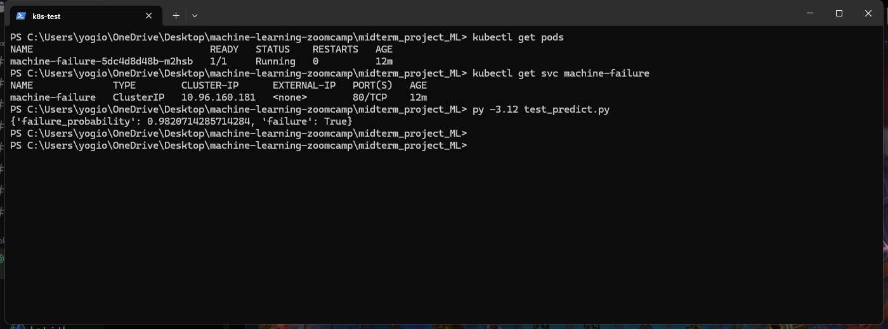

# Machine Failure Prediction (ML Zoomcamp Midterm Project)

Predict whether a milling machine is about to fail, based on its process readings, and serve the model as a web API.

## Problem description

Unplanned downtime is one of the most expensive problems in manufacturing. When a machine breaks mid-run, production stops, parts get scrapped, and the repair usually costs more than planned maintenance would have. Predictive maintenance tries to spot the warning signs early enough to step in before that happens.

This project uses the AI4I 2020 dataset. Each of its 10,000 rows is a snapshot of a milling machine: the product quality variant (L/M/H), air and process temperature, spindle speed, torque and tool wear, plus whether the machine failed. The model takes these readings and predicts the chance of failure. It runs as a web service: a monitoring system sends the current readings to `/predict` and gets back a failure probability and a `failure` flag. If the probability is above the threshold, a maintenance alert is raised.

Failures are rare (3.4% of rows), so accuracy is misleading: always predicting "no failure" already scores 96.6%. Missing a failure (unplanned downtime) costs far more than a false alarm (an extra inspection), so the model is judged by **PR AUC**, which focuses on the failure class. The decision threshold (0.24) is chosen to maximise the F2 score, which counts recall twice as much as precision.

## Dataset

[AI4I 2020 Predictive Maintenance Dataset](https://archive.ics.uci.edu/dataset/601/ai4i+2020+predictive+maintenance+dataset) from the UCI Machine Learning Repository, licensed CC BY 4.0. It has 10,000 rows. The data is synthetic but modelled on real industrial predictive-maintenance data.

| Feature | Description |
|---|---|
| `type` | Product quality variant: L / M / H |
| `air_temperature` | Air temperature [K] |
| `process_temperature` | Process temperature [K] |
| `rotational_speed` | Spindle speed [rpm] |
| `torque` | Torque [Nm] |
| `tool_wear` | Tool wear [min] |
| **`machine_failure`** | **Target (0/1)** |

The ID columns and the five failure-mode columns (`TWF`, `HDF`, `PWF`, `OSF`, `RNF`) are dropped. The failure modes describe *why* a machine failed, so using them as features would leak the target.

Three features are engineered in `features.py`, each matching a real failure type:

| Feature | Formula | Why |
|---|---|---|
| `temp_diff` | process − air temperature | Heat-dissipation failures happen when the gap is small |
| `power` | torque × rotational speed × 2π / 60 (W) | Power failures happen at very low or very high power |
| `strain` | tool wear × torque | Overstrain failures happen when a worn tool is under high torque |

The CSV is committed at `data/ai4i2020.csv`. To re-download it:

```bash
pipenv run python download_data.py
```

## Project structure

```
├── data/ai4i2020.csv      # dataset
├── notebook.ipynb         # cleaning, EDA, feature importance, model selection & tuning
├── features.py            # feature prep shared by training and serving
├── train.py               # trains the final model -> model.bin
├── predict.py             # FastAPI web service
├── test_predict.py        # sends a sample request to the service
├── download_data.py       # downloads the dataset
├── Pipfile / Pipfile.lock # dependencies
├── Dockerfile
├── k8s/                   # Kubernetes manifests
└── images/                # screenshots of the deployed service
```

## Results

Each model was tuned on the validation set (60/20/20 stratified split):

| Model | Val PR AUC | Val ROC AUC |
|---|---|---|
| Logistic regression | 0.473 | 0.898 |
| Decision tree | 0.861 | 0.982 |
| **Random forest** | **0.865** | 0.978 |
| XGBoost | 0.852 | 0.985 |

The validation set has only 68 failures, so the two best models were also compared with 5-fold cross-validation on train+val: random forest scored **0.900 ± 0.024** PR AUC and XGBoost 0.881 ± 0.027. Without the engineered features, the random forest drops to 0.761.

**Final model:** random forest (`n_estimators=300`, `max_depth=10`, `min_samples_leaf=3`) trained on train+val, with a decision threshold of **0.24**.

| Test metric | Value |
|---|---|
| PR AUC | 0.899 |
| ROC AUC | 0.982 |
| Precision @ 0.24 | 0.879 |
| Recall @ 0.24 | 0.853 (58 of 68 failures caught, 8 false alarms) |

## How to run

### 1. Install dependencies (Pipenv)

```bash
pip install pipenv
pipenv install --dev
pipenv shell
```

### 2. Notebook

```bash
jupyter notebook notebook.ipynb
```

### 3. Train the model

```bash
python train.py
```

This writes `model.bin`.

### 4. Run the service locally

```bash
uvicorn predict:app --host 0.0.0.0 --port 9696
```

Then, in another terminal:

```bash
python test_predict.py
```

Interactive API docs are available at http://localhost:9696/docs.

### 5. Docker

```bash
docker build -t machine-failure:v1 .
docker run -it --rm -p 9696:9696 machine-failure:v1
python test_predict.py
```

### 6. Kubernetes (local cluster with kind)

```bash
kind create cluster
kind load docker-image machine-failure:v1
kubectl apply -f k8s/deployment.yaml
kubectl apply -f k8s/service.yaml
kubectl get pods
kubectl port-forward service/machine-failure 9696:80
python test_predict.py
```

Wait until `kubectl get pods` shows `READY 1/1` before port-forwarding.



Example request:

```bash
curl -X POST http://localhost:9696/predict \
  -H "Content-Type: application/json" \
  -d '{"type":"L","air_temperature":298.9,"process_temperature":309.1,"rotational_speed":1350,"torque":62.5,"tool_wear":220}'
```

Example response:

```json
{"failure_probability": 0.982, "failure": true}
```
